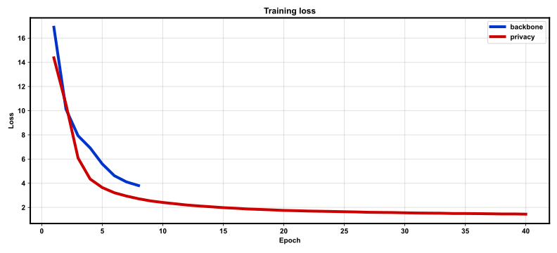
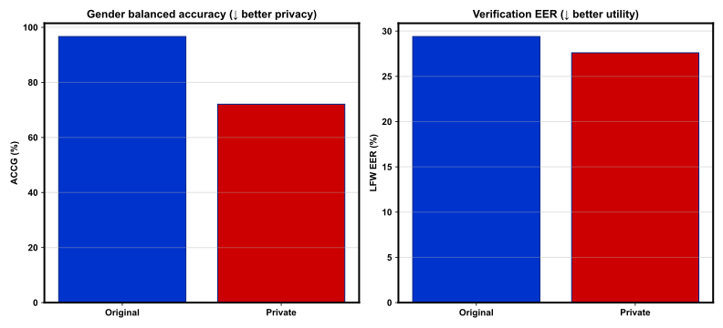

# REPORT: Gender Privacy Angular Constraints — full

**Protocol:** `full`  
**Package:** `gpriv`  

## Summary

| Embedding | LFW Acc | LFW EER | ACCG |
|-----------|---------|---------|------|
| Original | 70.60% | 29.40% | 96.65% |
| Private (Lp1+Lp2) | 72.40% | 27.60% | 72.08% |

- PIC proxy (PG−IL): **0.2637** (PG=0.2457, IL=-0.0180)

## Training

- Backbone epochs: 8
- Privacy epochs: 40
- Train images: 141610
- Identities: 7124
- alpha / beta: 20.0 / 1.0
- Elapsed: 2658.43 s
- Checkpoint: `outputs/checkpoints/full/last.pt`

## Figures

### `train_loss.svg`



### `privacy_utility.svg`



## Reproduce

```bash
bash scripts/smoke.sh
bash scripts/train_full.sh
bash scripts/report.sh configs/default.yaml
```

## Notes

- CelebA for train + gender probe; LFW pairs for verification.
- VGGFace2 / AgeDB / ColorFeret omitted (see DEVIATIONS.md).
